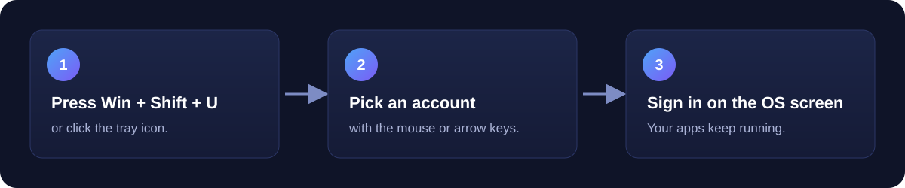
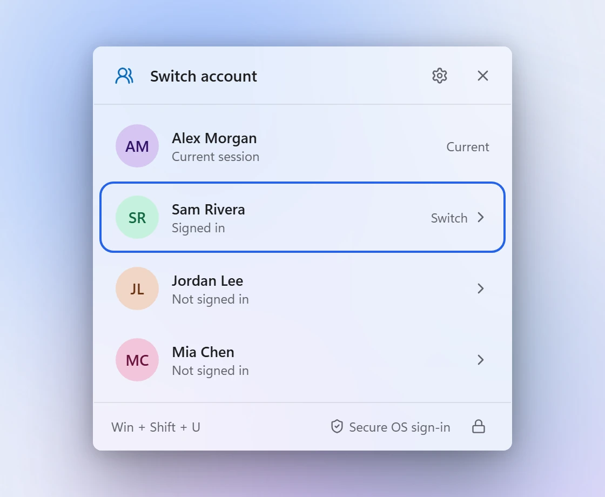
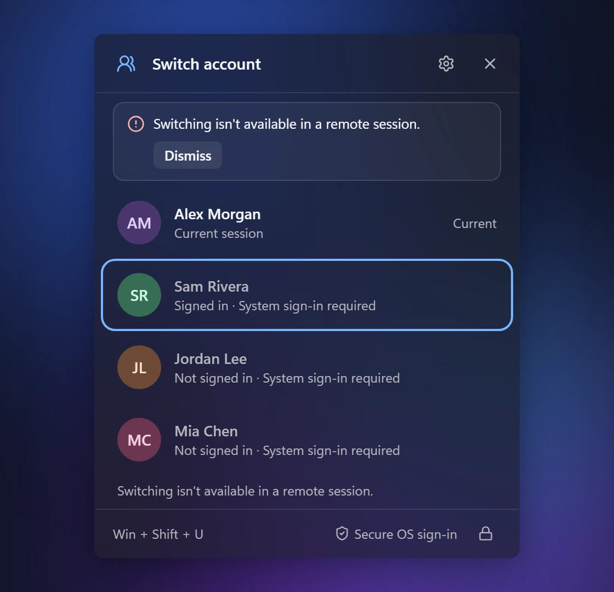

<p align="center">
  
</p>

<p align="center">
  <a href="../../releases/latest"></a>
  
  
  
</p>

<p align="center">
  <b>One shortcut. Every account on your computer. Zero passwords handed to an app.</b><br>
  A small tray utility that feels like it shipped with Windows 11.
</p>

<br>

<picture>
  <source media="(prefers-color-scheme: light)" srcset="assets/readme/hero-light.webp">
  
</picture>

## Why you'll like it

Sharing one PC between work and personal accounts, or with family? Normally that means opening Start, finding your profile picture and clicking *Switch user*. Fluent Account Switcher puts every account one keystroke away, in a panel that looks and feels like the rest of Windows 11.

- **⚡ Instant.** Press <kbd>Win</kbd> + <kbd>Shift</kbd> + <kbd>U</kbd> and the panel appears above your taskbar.
- **👀 Honest status.** See at a glance who is *signed in*, who is *signed in remotely* and who is *not signed in*.
- **🔐 Your OS stays in charge.** The app never asks for your password. Windows or your Linux login screen does the signing in, exactly as it normally would.
- **🪟 Native look.** Acrylic glass, rounded corners, light and dark themes that follow your system.
- **⌨️ Keyboard first.** Arrow keys, <kbd>Enter</kbd> and <kbd>Esc</kbd>. No mouse required.
- **🪶 Lightweight.** A ~1.3 MB installer that sits quietly in the tray and uses almost no CPU when idle.

## How it works

<p align="center">
  
</p>

When you pick another account, the app hides and hands over to the operating system:

- **On Windows** your session stays open in the background and the Windows sign-in screen appears. Choose the account there and sign in. Everything you had open is still there when you switch back.
- **On Linux** the app locks your session first, then opens your login screen (GDM, LightDM or SDDM).

## A closer look

<table>
  <tr>
    <td width="33%" align="center"><br><sub><b>Light or dark</b><br>Follows your system, or pick one.</sub></td>
    <td width="33%" align="center"><br><sub><b>Simple settings</b><br>Startup, shortcut, theme and motion.</sub></td>
    <td width="33%" align="center"><br><sub><b>Clear when it can't</b><br>Tells you why, and what you can do instead.</sub></td>
  </tr>
</table>

## Download

| Your system | What to download |
| --- | --- |
| **Windows 11** (64-bit) | `Fluent Account Switcher_x.y.z_x64-setup.exe` — installs just for you, no admin rights needed. An `.msi` is also available. |
| **Ubuntu / Debian** | `Fluent Account Switcher_x.y.z_amd64.deb` |
| **Fedora / openSUSE** | `Fluent Account Switcher-x.y.z-1.x86_64.rpm` |
| **Any Linux** | `Fluent Account Switcher_x.y.z_amd64.AppImage` |

Grab the files from the [**latest release**](../../releases/latest).

> [!NOTE]
> The installers aren't code-signed yet, so Windows SmartScreen may say it *protected your PC*. Click **More info → Run anyway** if you trust the download.

<details>
<summary><b>Install on Linux from the terminal</b></summary>

```sh
# Ubuntu / Debian
sudo apt install "./Fluent Account Switcher_x.y.z_amd64.deb"

# Fedora / openSUSE
sudo dnf install "./Fluent Account Switcher-x.y.z-1.x86_64.rpm"

# AppImage
chmod +x Fluent*.AppImage && ./Fluent*.AppImage
```

</details>

## Getting started

1. Install and launch **Fluent Account Switcher**. It opens once so you can see it, then lives in your system tray.
2. Press <kbd>Win</kbd> + <kbd>Shift</kbd> + <kbd>U</kbd> any time, or click the tray icon.
3. Pick an account. That's it.

Want it ready every time you sign in? Open **Settings → Launch at sign-in**.

### Keyboard shortcuts

| Keys | Action |
| --- | --- |
| <kbd>Win</kbd> + <kbd>Shift</kbd> + <kbd>U</kbd> | Open or close the switcher (you can change this in Settings) |
| <kbd>↑</kbd> <kbd>↓</kbd> <kbd>Home</kbd> <kbd>End</kbd> | Move between accounts |
| <kbd>Enter</kbd> or <kbd>Space</kbd> | Switch to the selected account |
| <kbd>Esc</kbd> | Leave Settings, then close the panel |

### Tray menu

Right-click the tray icon for **Open account switcher**, **Lock screen**, **Settings** and **Quit**.

## Privacy and security

Your accounts are protected by your operating system, and this app is built to keep it that way.

- **No passwords, PINs or tokens.** The app has no password field and no way to receive one.
- **No direct access to other desktops.** Another person's session is never opened without the OS asking them to sign in.
- **Nothing leaves your PC.** No accounts, analytics, ads, update pings or network requests.
- **Almost nothing is saved.** Only your preferences (theme, shortcut, compact rows, reduce motion). Never account names or session details.
- **No admin rights, no services.** It runs as you, installs nothing in the background and adds nothing to the login process.

## Platform support

| | Windows 11 | Linux (GNOME, KDE and others with systemd) |
| --- | --- | --- |
| See accounts and sessions | ✅ | ✅ |
| Switch via the system sign-in screen | ✅ | ✅ GDM, LightDM, SDDM |
| Global shortcut | ✅ | ✅ on X11 · ⚠️ Wayland: add a custom shortcut instead (see FAQ) |
| Glass (Acrylic) background | ✅ | Solid Fluent-style background |
| Lock screen from the tray | ✅ | ✅ |

> [!IMPORTANT]
> This is an early release (0.1). Linux support is a preview and hasn't been tested on every desktop yet. If something doesn't work on your setup, please open an issue with your distribution, desktop and login screen.

## FAQ

<details>
<summary><b>Why doesn't Windows jump straight into the account I picked?</b></summary>

Windows doesn't let apps sign anyone in, and that's a good thing. The app takes you to the Windows sign-in screen, where you pick the account and sign in as usual. Your own session keeps running in the background.

</details>

<details>
<summary><b>Will I lose my open apps when I switch?</b></summary>

No. Switching never signs you out. When you come back to your account, everything is where you left it.

</details>

<details>
<summary><b>The shortcut doesn't work. What can I do?</b></summary>

Another app may already use <kbd>Win</kbd> + <kbd>Shift</kbd> + <kbd>U</kbd>. The panel footer will say *Shortcut unavailable*. Open **Settings → Shortcut**, click the field and press a new combination. You can always use the tray icon.

On Linux with Wayland, apps can't register global shortcuts. Add a custom shortcut in your desktop's keyboard settings that runs:

```sh
fluent-account-switcher --toggle
```

</details>

<details>
<summary><b>Why can't I switch from a Remote Desktop session?</b></summary>

Switching users is a feature of the physical screen, so it isn't offered inside a remote session. The panel tells you when that's the case.

</details>

<details>
<summary><b>Which accounts are shown?</b></summary>

On Windows: everyone signed in, plus the local accounts that appear on the Windows sign-in screen. Disabled and hidden accounts are left out. On Linux: users signed in to the desktop, plus those your login screen lists.

</details>

<details>
<summary><b>How do I uninstall it?</b></summary>

- **Windows:** Settings → Apps → Installed apps → *Fluent Account Switcher* → Uninstall. Tick *Delete the application data* to remove your preferences too.
- **Linux:** remove the package (`sudo apt remove fluent-account-switcher` or `sudo dnf remove fluent-account-switcher`). To remove your preferences, delete `~/.config/com.fluentaccountswitcher.desktop`.

Nothing else is left behind.

</details>

## For developers

<details>
<summary><b>Build from source</b></summary>

Built with [Tauri 2](https://v2.tauri.app/), Rust, React, TypeScript and Tailwind CSS.

**Prerequisites**

- Node.js LTS (24+) and pnpm 12 (`corepack enable`)
- Rust stable (1.90+)
- Windows: Visual Studio Build Tools with the C++ workload
- Debian/Ubuntu: `sudo apt install libwebkit2gtk-4.1-dev libayatana-appindicator3-dev librsvg2-dev libxdo-dev libssl-dev build-essential file patchelf`

```sh
pnpm install --frozen-lockfile
pnpm tauri dev      # run with hot reload
pnpm tauri build    # installers in src-tauri/target/release/bundle
```

**Checks**

```sh
pnpm lint && pnpm typecheck && pnpm test --run && pnpm build
cd src-tauri
cargo fmt --all -- --check
cargo clippy --all-targets --all-features -- -D warnings
cargo test
cargo test -- --ignored native_   # read-only check against your real OS session APIs
```

**Command-line options:** `--toggle` (show or hide the running instance), `--hidden` (start in the tray).

The screenshots in this README are rendered from the app's own components with sample accounts: `pnpm preview:readme`.

</details>

## License

[MIT](LICENSE) © Fluent Account Switcher contributors
