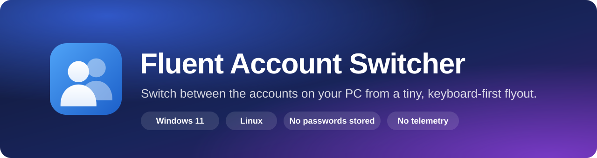
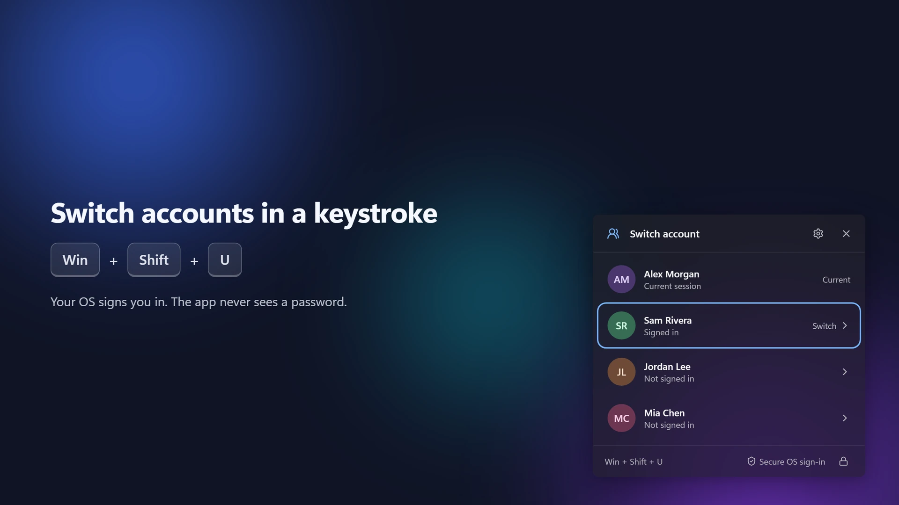
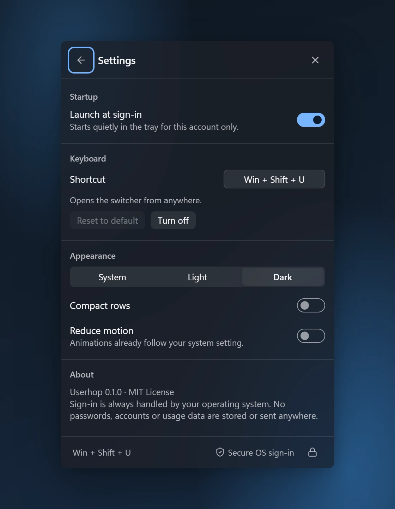

<p align="center">
  
</p>

<p align="center">
  <a href="../../releases/latest"></a>
  
  
  
  
</p>

<p align="center">
  <b>One shortcut. Every account on your computer. Zero passwords handed to an app.</b><br>
  A small tray and menu bar utility for Windows, macOS and Linux, with a clean Windows 11 Fluent look.
</p>

<br>

<p align="center">
  <a href="assets/readme/demo.mp4">
    
  </a>
  <br>
  <sub>▶ <a href="assets/readme/demo.mp4"><b>Watch in HD</b></a> (MP4, 1080p, 15 s)</sub>
</p>

## Why you'll like it

Sharing one computer between work and personal accounts, or with family? Normally that means digging through the Start menu, Control Center or your desktop's power menu to find *Switch user*. Fluent Account Switcher puts every account one keystroke away, in a compact panel inspired by Windows 11.

- **⚡ Instant.** Press <kbd>Win</kbd> + <kbd>Shift</kbd> + <kbd>U</kbd> (<kbd>⌃</kbd> <kbd>⌥</kbd> <kbd>U</kbd> on a Mac) and the panel appears next to your taskbar or menu bar.
- **👀 Honest status.** See at a glance who is *signed in*, who is *signed in remotely* and who is *not signed in*.
- **🔐 Your OS stays in charge.** The app never asks for your password. Windows, the macOS login window or your Linux login screen does the signing in, exactly as it normally would.
- **🪟 Native look.** Acrylic glass on Windows 11, vibrancy on macOS, rounded corners, light and dark themes that follow your system.
- **⌨️ Keyboard first.** Arrow keys, <kbd>Enter</kbd> and <kbd>Esc</kbd>. No mouse required.
- **🪶 Lightweight.** A ~1.3 MB Windows installer that sits quietly in the tray and uses almost no CPU when idle.

## How it works

<p align="center">
  
</p>

When you pick another account, the app hides and hands over to the operating system:

- **On Windows** your session stays open in the background and the Windows sign-in screen appears. Choose the account there and sign in. Everything you had open is still there when you switch back.
- **On macOS** the familiar macOS login window appears, just like when you use the Fast User Switching menu. Your session keeps running and needs your password to return.
- **On Linux** the app locks your session first, then opens your login screen (GDM, LightDM or SDDM).

## A closer look

<picture>
  <source media="(prefers-color-scheme: light)" srcset="assets/readme/hero-light.webp">
  
</picture>

<table>
  <tr>
    <td width="33%" align="center"><br><sub><b>Light or dark</b><br>Follows your system, or pick one.</sub></td>
    <td width="33%" align="center"><br><sub><b>Simple settings</b><br>Startup, shortcut, theme and motion.</sub></td>
    <td width="33%" align="center"><br><sub><b>Clear when it can't</b><br>Tells you why, and what you can do instead.</sub></td>
  </tr>
</table>

## Download

| Your system | What to download |
| --- | --- |
| **Windows 10 or 11** (64-bit) | `Fluent Account Switcher_x.y.z_x64-setup.exe` — installs just for you, no admin rights needed. An `.msi` is also available. On Windows 10 the installer fetches Microsoft Edge WebView2 if it isn't installed yet. |
| **macOS 11 or later** (Apple Silicon and Intel) | `Fluent Account Switcher_x.y.z_universal.dmg` — open it and drag the app to **Applications**. |
| **Ubuntu / Debian** | `Fluent Account Switcher_x.y.z_amd64.deb` |
| **Fedora / openSUSE** | `Fluent Account Switcher-x.y.z-1.x86_64.rpm` |
| **Any Linux** | `Fluent Account Switcher_x.y.z_amd64.AppImage` |

Grab the files from the [**latest release**](../../releases/latest).

> [!NOTE]
> The downloads aren't code-signed yet.
> - **Windows:** SmartScreen may say it *protected your PC*. Click **More info → Run anyway** if you trust the download.
> - **macOS:** the app isn't notarized, so the first launch is blocked. Open **System Settings → Privacy & Security** and click **Open Anyway**, or Control-click the app and choose **Open**.

<details>
<summary><b>Install on Linux from the terminal</b></summary>

```sh
# Ubuntu / Debian
sudo apt install "./Fluent Account Switcher_x.y.z_amd64.deb"

# Fedora / openSUSE
sudo dnf install "./Fluent Account Switcher-x.y.z-1.x86_64.rpm"

# AppImage
chmod +x Fluent*.AppImage && ./Fluent*.AppImage
```

</details>

## Getting started

1. Install and launch **Fluent Account Switcher**. It opens once so you can see it, then lives in your system tray (the menu bar on macOS).
2. Press <kbd>Win</kbd> + <kbd>Shift</kbd> + <kbd>U</kbd> any time (<kbd>⌃</kbd> <kbd>⌥</kbd> <kbd>U</kbd> on a Mac), or click the tray icon.
3. Pick an account. That's it.

Want it ready every time you sign in? Open **Settings → Launch at sign-in**.

### Keyboard shortcuts

| Keys | Action |
| --- | --- |
| <kbd>Win</kbd> + <kbd>Shift</kbd> + <kbd>U</kbd> · Mac: <kbd>⌃</kbd> <kbd>⌥</kbd> <kbd>U</kbd> | Open or close the switcher (you can change this in Settings) |
| <kbd>↑</kbd> <kbd>↓</kbd> <kbd>Home</kbd> <kbd>End</kbd> | Move between accounts |
| <kbd>Enter</kbd> or <kbd>Space</kbd> | Switch to the selected account |
| <kbd>Esc</kbd> | Leave Settings, then close the panel |

### Tray and menu bar

Right-click the tray icon (on macOS, the menu bar icon) for **Open account switcher**, **Lock screen**, **Settings** and **Quit**. On macOS the app lives only in the menu bar, not in the Dock.

## Privacy and security

Your accounts are protected by your operating system, and this app is built to keep it that way.

- **No passwords, PINs or tokens.** The app has no password field and no way to receive one.
- **No direct access to other desktops.** Another person's session is never opened without the OS asking them to sign in.
- **Nothing leaves your computer.** No accounts, analytics, ads, update pings or network requests.
- **Almost nothing is saved.** Only your preferences (theme, shortcut, compact rows, reduce motion). Never account names or session details.
- **No admin rights, no services.** It runs as you, installs nothing in the background and adds nothing to the login process.

## Platform support

| | Windows 10/11 | macOS 11+ | Linux (GNOME, KDE and others with systemd) |
| --- | --- | --- | --- |
| See accounts and sessions | ✅ | ✅ | ✅ |
| Switch via the system sign-in screen | ✅ | ✅ macOS login window | ✅ GDM, LightDM, SDDM |
| Global shortcut | ✅ | ✅ | ✅ on X11 · ⚠️ Wayland: add a custom shortcut instead (see FAQ) |
| Glass background | ✅ Acrylic on Windows 11 · solid on Windows 10 | ✅ Vibrancy | Solid Fluent-style background |
| Lock screen from the tray | ✅ | ✅ | ✅ |

> [!IMPORTANT]
> This is an early release (0.1). Windows 10, macOS and Linux haven't been tested on every system yet. If something doesn't work on your setup, please open an issue with your OS version, desktop and login screen.

## FAQ

<details>
<summary><b>Why doesn't Windows jump straight into the account I picked?</b></summary>

Windows doesn't let apps sign anyone in, and that's a good thing. The app takes you to the Windows sign-in screen, where you pick the account and sign in as usual. Your own session keeps running in the background.

</details>

<details>
<summary><b>Will I lose my open apps when I switch?</b></summary>

No. Switching never signs you out. When you come back to your account, everything is where you left it.

</details>

<details>
<summary><b>The shortcut doesn't work. What can I do?</b></summary>

Another app may already use the shortcut. The panel footer will say *Shortcut unavailable*. Open **Settings → Shortcut**, click the field and press a new combination. You can always use the tray icon.

On Linux with Wayland, apps can't register global shortcuts. Add a custom shortcut in your desktop's keyboard settings that runs:

```sh
fluent-account-switcher --toggle
```

</details>

<details>
<summary><b>Does it work on Windows 10?</b></summary>

Yes. Everything works the same as on Windows 11; the panel just uses a solid background, because the Acrylic glass effect is only available on Windows 11. Keep in mind that Microsoft no longer provides security updates for Windows 10 for most people.

</details>

<details>
<summary><b>How does switching work on a Mac?</b></summary>

The app asks macOS to show its login window, the same thing that happens when you pick *Login Window…* from the Fast User Switching menu. macOS has no official developer API for this, so the app uses the same built-in system component that menu uses, and checks that it exists every time. If a future macOS version changes it, or your administrator has turned off fast user switching, the panel shows switching as unavailable instead of doing anything unexpected. Locking the screen works the same way.

</details>

<details>
<summary><b>Why can't I switch from a Remote Desktop session?</b></summary>

Switching users is a feature of the physical screen, so it isn't offered inside a remote session. The panel tells you when that's the case.

</details>

<details>
<summary><b>Which accounts are shown?</b></summary>

On Windows: everyone signed in, plus the local accounts that appear on the Windows sign-in screen. Disabled and hidden accounts are left out. On Linux: users signed in to the desktop, plus those your login screen lists.

</details>

<details>
<summary><b>How do I uninstall it?</b></summary>

- **Windows:** Settings → Apps → Installed apps → *Fluent Account Switcher* → Uninstall. Tick *Delete the application data* to remove your preferences too.
- **macOS:** turn off **Settings → Launch at sign-in**, quit the app from the menu bar and drag it from **Applications** to the Trash. To remove your preferences, delete `~/Library/Application Support/com.fluentaccountswitcher.desktop`.
- **Linux:** remove the package (`sudo apt remove fluent-account-switcher` or `sudo dnf remove fluent-account-switcher`). To remove your preferences, delete `~/.config/com.fluentaccountswitcher.desktop`.

Nothing else is left behind.

</details>

## For developers

<details>
<summary><b>Build from source</b></summary>

Built with [Tauri 2](https://v2.tauri.app/), Rust, React, TypeScript and Tailwind CSS.

**Prerequisites**

- Node.js LTS (24+) and pnpm 12 (`corepack enable`)
- Rust stable (1.90+)
- Windows: Visual Studio Build Tools with the C++ workload
- macOS: Xcode Command Line Tools (`xcode-select --install`)
- Debian/Ubuntu: `sudo apt install libwebkit2gtk-4.1-dev libayatana-appindicator3-dev librsvg2-dev libxdo-dev libssl-dev build-essential file patchelf`

```sh
pnpm install --frozen-lockfile
pnpm tauri dev      # run with hot reload
pnpm tauri build    # installers in src-tauri/target/release/bundle
```

**Checks**

```sh
pnpm lint && pnpm typecheck && pnpm test --run && pnpm build
cd src-tauri
cargo fmt --all -- --check
cargo clippy --all-targets --all-features -- -D warnings
cargo test
cargo test -- --ignored native_   # read-only check against your real OS session APIs
```

**Command-line options:** `--toggle` (show or hide the running instance), `--hidden` (start in the tray).

The screenshots and the demo video in this README are rendered from the app's own components with sample accounts (`pnpm preview:readme`, add `?video=1` for the animated timeline). To re-record the video, build the preview and capture it frame by frame with any Chromium-based browser, then encode with ffmpeg:

```sh
pnpm build:readme-preview
node scripts/record-readme-video.mjs --browser "<path to chrome or msedge>" \
  --url "file://$PWD/dist-preview/preview/index.html?video=1" --out .video
ffmpeg -framerate 30 -i .video/frames/frame-%05d.png -c:v libx264 -crf 18 -pix_fmt yuv420p \
  -movflags +faststart assets/readme/demo.mp4
ffmpeg -framerate 30 -i .video/frames/frame-%05d.png -vf "fps=20,scale=960:-1:flags=lanczos" \
  -c:v libwebp_anim -quality 95 -loop 0 assets/readme/demo.webp
```

</details>

## License

[MIT](LICENSE) © Fluent Account Switcher contributors
